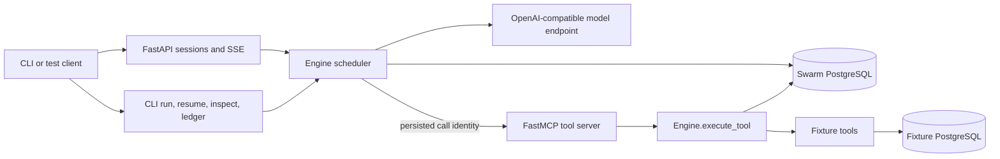
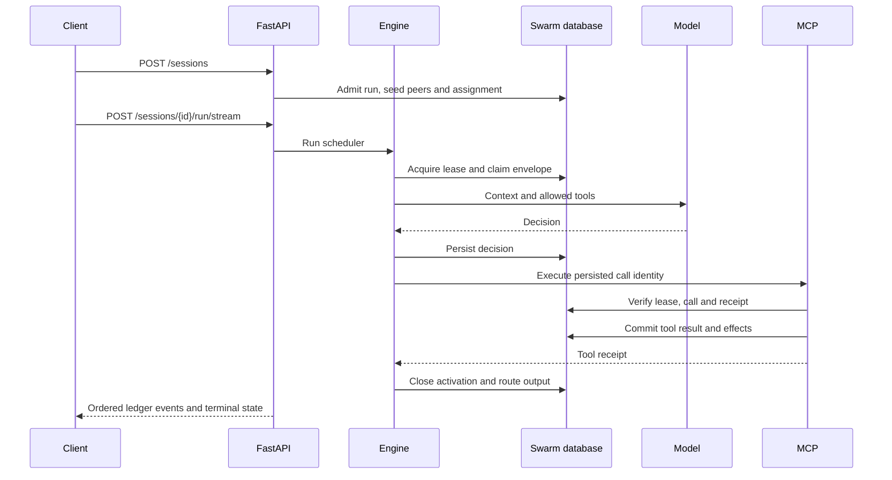
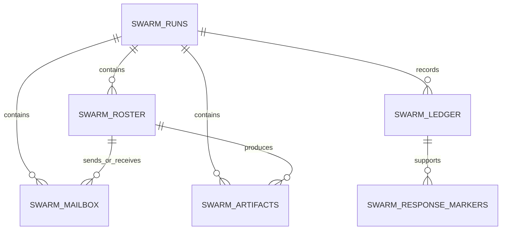
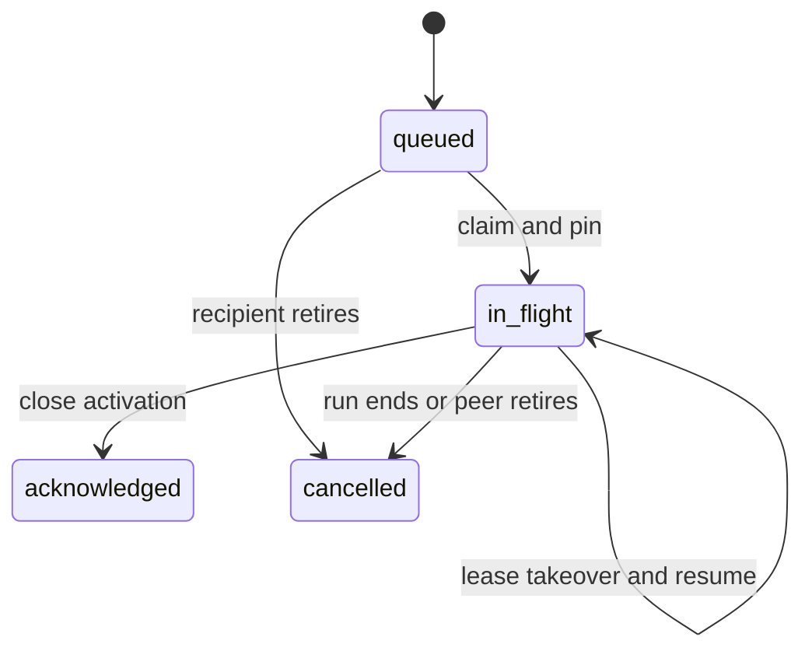

# Implemented architecture

Universal Swarms is a Python application with a CLI, FastAPI session service, FastMCP tool service, a shared scheduler and PostgreSQL storage. Profiles under `config/` select peers, tools and workflow rules. The architecture below describes the code in `src/universal_swarms/`.

## Components

| Component | Implementation | Responsibility |
| --- | --- | --- |
| CLI | `__init__.py` | Loads environment, migrates, runs or resumes a profile, and inspects or exports a run. |
| HTTP service | `api.py` | Admits sessions, returns projections and streams committed events. |
| Scheduler | `runtime.py` | Leases and claims work, constructs context, invokes the model and MCP, validates results and closes activations. |
| Tool service | `mcp_server.py` | Resolves a persisted call for an in-flight activation and invokes the shared tool executor. |
| Store | `store.py`, `schema.sql` | PostgreSQL state, admission, event sequencing and state projection. |
| Model adapter | `llm.py` | Chat-completions requests, response parsing, argument parsing and provider diagnostics. |
| Profiles and fixtures | `config.py`, `fixtures.py`, `config/*.yaml` | Tool definitions, profile validation and scenario-specific fixture operations. |

## Request and activation sequence

The scheduler can make several model calls per activation. A terminal tool stages a routing intent for closure. The API event stream reads the same ledger that supports inspection. MCP validates the run lease, fence, in-flight message, persisted decision and call position before executing a call.

## Data model

- `swarm_runs` stores admission identity, goal, resolved profile, status, deadline, lease, fence and final answer.
- `swarm_roster` stores peer identity, template, prompt revision, creator, grants, lifetime counters and retirement reason.
- `swarm_mailbox` stores envelopes, correlation and reply references, delivery state, activation, fence and pinned snapshot.
- `swarm_artifacts` stores immutable key/version content and producer.
- `swarm_ledger` stores ordered events and operation receipts. A run-scoped operation key is unique.
- `swarm_response_markers` records learned model response markers linked to ledger evidence.

The schema uses run-scoped peer and message foreign keys. The database migration is `universal-swarms migrate`. The fixture database is configured separately using `STATE_DATABASE_URL`.

## State and recovery

A run lease has an owner, expiry and monotonically increasing fence. Guarded mutations check ownership and lease against database time. The scheduler renews the lease during external calls. After takeover, it resumes an in-flight envelope with its pinned snapshot and reconstructs decisions and tool receipts from the ledger. A tool operation is identified by activation, decision sequence and call position. An existing receipt is reused only when its fingerprint matches.

A committed final response creates a `final_answer` artifact and ends the run. A deadline, exhausted activation or call budget, or lack of runnable work can end it as blocked. Termination retires remaining peers and cancels outstanding work.

## Interfaces and configuration

The API supports `POST /sessions`, `GET /sessions/{run_id}` and `POST /sessions/{run_id}/run/stream`. The stream can replay events using `Last-Event-ID`. The CLI exposes `migrate`, `migrate-fixtures`, `serve`, `run`, `resume`, `inspect` and `ledger`.

The profile loader validates configuration and records the resolved profile in the run. Credentials are supplied through the environment. See [README.md](../README.md) for startup and [test.md](test.md) for executable scenarios.
