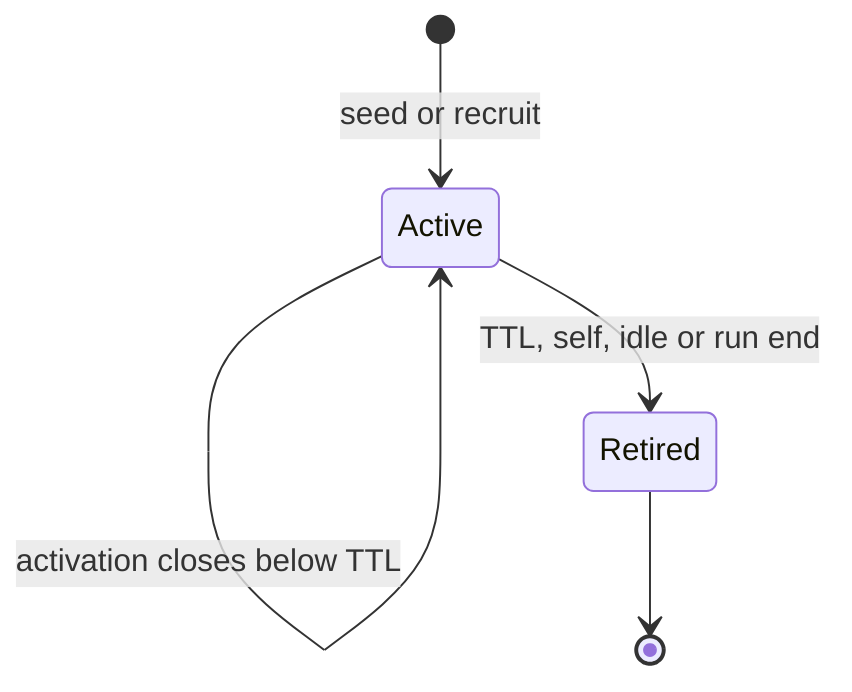

# Concepts and theory of operation

A swarm is a run-scoped set of peers working toward a goal. A profile defines the initial roster, coordinator, role templates, tools, optional phases and completion rules. Admission creates a run and its initial assignment. The scheduler selects an envelope, gives its recipient a bounded activation, and repeats until the coordinator completes or the run blocks.

## Peers and activations

A peer has a UUID, name, template, prompt revision, grants, creator and optional turn TTL. Initial peers come from the profile. An authorized peer recruits a new peer using a permitted template. The runtime assigns its identity and creator, enforces active-peer and recruitment limits, and records the creation and roster mutation.

One activation handles one mailbox envelope. Its prompt, grants and phase are pinned at claim time. Model and tool calls inside that activation do not individually consume TTL turns. Closing it increments the peer's turn counter. A peer with a positive TTL retires on its final turn. A peer can also request retirement, and configured idle sweeping can retire bounded peers without pending work. Run termination retires remaining peers. Retirement preserves history, cancels pending mail to the retired identity and can send delivery-failure notices to active senders. Reusing a retired name creates a new identity.

## Mailboxes and handoffs

An envelope carries a recipient, sender when applicable, kind, payload, correlation ID and optional reply reference. Assignments request work. Handoffs transfer work or findings. Results, retirement notices and delivery failures communicate outcomes. The scheduler claims queued messages in order and resumes in-flight work first after takeover. The runtime validates recipients and artifact references before routing.

## Artifacts and ledger

Artifacts hold task data such as a policy or cache design. A write creates a new version under a key. A caller can supply an expected version to detect conflicting edits. Artifact review bindings take the version in the current handoff and substitute its content into the checking tool's configured argument. The recorded receipt identifies the bound version. Review acceptance checks the passed version and, where configured, its freshness.

The ledger is the ordered, run-scoped record of admissions, claims, model attempts and decisions, tool receipts, roster changes, artifact writes, routing and termination. Tool receipts carry stable operation identities and fingerprints. They allow recovery to reuse committed effects rather than apply them twice. Mutable tables hold current state alongside the ledger. A repeated model inference is possible if the worker fails before persisting its response.

## Review, recruitment and mutation

A profile can bind a review tool to a submission or artifact and define its success result. On failed evidence, the reviewer can inspect a permitted peer and resolve the review. A retry retains the inspected peer's prompt and grants. A mutation supplies a replacement prompt or permitted grant change. Recruitment creates a specialist from an authorized template. Review resolution records its evidence and sends a task and relevant artifact references.

For an existing peer, mutation requires an authorized target, current inspection, diagnosis and matching revision. Tool changes are limited by configured grants and required tools. The update increments the revision. Existing in-flight activations keep their pinned snapshot. A recruited specialist's creator and TTL are set at creation.

The policy scenario uses a two-activation specialist. Counsel submits a revision using the assigned artifact version, then receives a confirmation or correction assignment. After its second handoff, the critic reviews the returned version before acceptance. The cache scenario binds an explicit critique to a version and runs the configured simulator after the verdict. Profiles determine these protocols.

## Guardrails and completion

The runtime validates tool names, JSON arguments, schemas, routing, artifact access, peer grants and configured prerequisites. Profiles can constrain phases, evidence, allowed mutation targets, recruitment templates, parent-only routing and final output. The default bounds cover activations, model calls, tool calls, active peers, recruitments and deadline. A successful accepted artifact or measured result can be published from its recorded receipt after final checks.

These controls apply within a trusted profile and configured tools. They bound and validate orchestration; the correctness of model-authored content and the capabilities of external tools depend on their own implementations and inputs.
